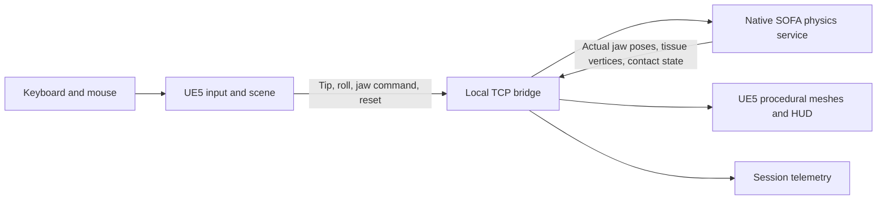

# EndoForge

**Endoscopic training, grounded in physics.**

EndoForge explores a practical route from a desktop soft-tissue interaction prototype to a laparoscopic skills training environment. Unreal Engine 5 handles the view, instruments, materials and interaction. A separate native SOFA process owns tissue deformation and contact mechanics.

The long-term goal is to support grasping, traction, cutting and suturing in increasingly realistic training tasks, with measurable behavior and reproducible verification. The current implementation is **Phase 2: one virtual grasper interacting with a deformable training pad**, operated entirely with a keyboard and mouse.

**Status:** locally tested Windows engineering prototype. Material parameters, forces and training outcomes have **not** been clinically validated. The screenshots show the running application; they are not concept renders.

[Build guide](docs/BUILDING.md) · [Roadmap](docs/ROADMAP.md) · [Physics model](Physics/README.md) · [Verification summary](docs/verification/phase2-summary.json) · [Third-party dependencies](docs/THIRD_PARTY.md)

## In the application

The current UE project and executable retain the technical identifier `LapTrainer`. Both images below show the verified Phase 2 baseline with its earlier `LAP / TRAINER` HUD branding; EndoForge is the public project name.


*Contact-supported grasp and traction. The visible tissue follows the SOFA solution; the overlay reports the current interaction state and model telemetry.*


*Procedural instrument geometry: two separate jaws, recessed teeth, shallow grooves, bevels, hinge hardware, shaft and insulation. The visible jaw details remain inside the collision envelopes.*

## What is implemented

| Area | Current implementation |
|---|---|
| Interaction | One virtual grasper; keyboard/mouse input; opening, closing, insertion, withdrawal and axial rotation |
| Tissue | A 120 × 80 × 12 mm training pad with a fixed rear edge; 351 FEM nodes and 1,152 tetrahedra |
| Mechanics | SOFA corotational linear-elastic FEM, implicit integration and native frictional constraint contact |
| Grasping | Opposing inner-jaw contact, a contact-load-based closing controller, frictional traction and natural slip/release |
| Support | Native SOFA constraint contact against a static tray plane |
| Tool motion | A fixed trocar pivot, insertion-distance and angular limits, and bounded actual translation/rotation speeds |
| Rendering | Smooth SOFA-bound tissue surface; 5,440 render vertices; 3,998 vertices across the two detailed jaw meshes |
| Observation | Endoscope-style, overhead, side and jaw-detail views; contact/grasp/slip/limit feedback; session CSV telemetry |
| Verification | Native physics and socket tests, UE input/integration checks, packaged and relocated-package checks |

The physics uses a fixed **1/30 s timestep** with a nominal 30 Hz schedule; UE rendering runs independently. This is not a hard real-time or haptic-frequency implementation. Surface subdivision improves appearance without increasing FEM resolution, and its geometric offset from the physical triangles is bounded to 0.1 mm.

The pad is homogeneous and isotropic, uses engineering material parameters, and currently runs without gravity to isolate tool-induced deformation. The jaws are prescribed kinematic collision surfaces. Grasping does not use the earlier prototype's proximity capture springs: tissue motion and sliding come from FEM and Coulomb contact, while a separate closing controller stops further closure after a supported opposing contact is established.

**Current scope excludes** a second instrument, physical cutting, suturing, anatomical organs, tissue self-collision, complete shaft collision, bleeding, physical instrument input and force feedback. Detailed mechanics, numerical safeguards and telemetry definitions are documented in the [physics reference](Physics/README.md).

## Architecture



The bridge uses protocol 2: newline-delimited JSON on `127.0.0.1:47322`. Physics coordinates use metres; the UE bridge converts them to centimetres. The rendered instrument follows the **returned actual jaw poses**, rather than assuming the requested pose was reached. Tissue is simulated only by SOFA; UE does not apply a second Chaos simulation to the same object.

The service checks commands, releases on communication loss, and reports solver health. UE checks complete state messages before applying them. Automated acceptance exercises the normal UE input path and inspects returned physical state.

| Location | Purpose |
|---|---|
| [`Prototype/LapTrainer`](Prototype/LapTrainer) | UE project, C++ scene/HUD/bridge, materials, map and asset-generation scripts |
| [`Physics`](Physics) | Native SOFA service, model, dependency manifest, build scripts and socket tests |
| [`Scripts`](Scripts) | Integration tests, distribution assembly and packaged launcher templates |
| [`docs`](docs) | Build instructions, roadmap, dependency notes and application screenshots |

## Build and try it

The developed and tested configuration is **Windows x64, UE 5.7.4, Visual Studio 2022 C++ tools and SOFA 26.06.00**. The physics dependencies are downloaded into `ThirdParty/` by a versioned, SHA-256-checked script. Unreal Engine and the Microsoft toolchain must be installed separately. No Blender, physical laparoscopic instrument, SofaPython3 or cloud service is needed for the current runtime.

Start with the [build guide](docs/BUILDING.md), including Git LFS setup for the UE assets and the required compiler/SDK configuration. From the repository root, the main entry points are:

```powershell
# Set this to your installed Unreal Engine directory.
$EngineRoot = 'C:\Program Files\Epic Games\UE_5.7'

& .\Physics\download-dependencies.ps1
& .\Physics\build.ps1
& .\Prototype\LapTrainer\Scripts\Build.ps1 -EngineRoot $EngineRoot

# Generates/re-generates the training map and procedural materials.
# See the build guide before replacing existing assets.
& .\Prototype\LapTrainer\Scripts\GenerateAssets.ps1 -EngineRoot $EngineRoot

# Starts the physics service and UE, runs Phase 2 acceptance, then exits.
& .\Scripts\RunPhase2Integration.ps1 -EngineRoot $EngineRoot
```

For manual play, start `Physics/runtime/LapPhysics.exe` in one terminal, then run `Prototype/LapTrainer/Scripts/RunEditor.ps1 -EngineRoot $EngineRoot -Game` in another. Only one Phase 2 service should own the default port at a time.

The source tree includes build, packaging and verification scripts. A packaged distribution has been built and tested locally, including after relocation to another directory. **An independent rebuild from a clean public clone has not yet been verified.** This repository does not promise a downloadable binary release; see [building and packaging](docs/BUILDING.md) for the existing workflow.

## First grasp

1. Wait for `PHYSICS LIVE`, then press **2**. This resets the pad, opens the jaws and selects the front-edge approach with 90° axial roll.
2. Press **Tab** for the overhead view. Keep the current height and use **Ctrl + arrow keys** to move slowly from outside the free edge toward the pad, approximately 9 mm. The arrows follow the camera's horizontal orientation.
3. Pause for about one second. Hold **Space** for at least about 1.6 seconds and wait for `GRIP`. The two inner jaw surfaces must contact opposite sides of the tissue; closing on its top surface alone is insufficient.
4. Keep holding **Space** and use **Ctrl + W** to raise the tool gently by roughly 5–8 mm. Further traction can produce sliding and loss of grasp.
5. Release **Space** to open. Reopen after slipping before attempting another grasp. Press **2** to restart the edge exercise or **R** for the general reset pose.

The tested edge approach moves the actual tip from approximately `(0, -46, 6)` to `(0, -37, 6)` mm at 90° roll. These are reproducibility references, not an anatomical target or a clinical technique instruction.

| Control | Action |
|---|---|
| Right mouse button + mouse, or arrow keys | Move horizontally relative to the camera |
| W / S, or mouse wheel | Raise / lower the tip |
| T / G | Insert / withdraw along the shaft |
| Q / E | Rotate around the shaft axis |
| Hold / release Space | Close / open the jaws |
| Ctrl / Shift + movement keys | Fine / faster command movement; backend limits still apply |
| 1 / 2 | Surface-contact / front-edge-grasp preset; both reset the exercise |
| R | Reset the exercise |
| Tab | Cycle endoscope, overhead, side and jaw-detail views |
| H | Toggle help |
| Esc / right mouse button | Release / recapture the mouse |
| F10 | Exit |

## Verification and interpretation

The local Phase 2 workflow has passed physics, network, editor-input, packaged and relocated-package checks; a [published verification summary](docs/verification/phase2-summary.json) records the accepted results without machine-specific paths or raw logs. The UE acceptance sequence covers surface contact, a sustained opposing grasp, **release by opening from a held state**, a second grasp, traction, frictional slip, tool limits, roll, reset and detail-view selection. It injects `PlayerController` key events through the normal input handler; it does not substitute an animated tissue deformation for the solver.

Use [`RunPhase2Integration.ps1`](Scripts/RunPhase2Integration.ps1) for editor integration and [`TestPhase2Package.ps1`](Scripts/TestPhase2Package.ps1) for an assembled distribution. The main UE result is `phase2-input-test.json`, accompanied by screenshots and logs. Require `phase: 2`, `passed: true` and an empty `failures` array. The report includes explicit health, penetration, geometry-binding and sustained-traction checks. Local generated evidence is written under `output/verification/` and is not included merely by cloning the source.

`-LapPhase2Test` is the Phase 2 acceptance mode. `-LapAutoDemo` and `-LapKeyTest` remain older debugging modes and must not be used to claim Phase 2 acceptance. `-LapVisualPreview` is a static geometry/material preview that deliberately does not connect to physics.

Two telemetry distinctions matter:

- **Contact load** is the sum of jaw-contact force magnitudes, derived from the constraint impulses. It is not the instrument's net reaction force, a measured handle force or a tissue-damage threshold.
- **Residual penetration** is a sampled geometric audit. A zero result means no overlap was found at those samples, not that every pair of continuous surfaces was proven intersection-free.

Software verification establishes behavior of this implementation on the tested configuration. It does not establish biomechanical accuracy, learning effectiveness or suitability for clinical decisions.

## Where this is going

The next development milestone is **two instruments and physical cutting of a thin membrane**. Later work targets needle/thread mechanics and suturing, anatomical scenes, material and instrument calibration, and clinician-led evaluation. Each stage needs its own physical model, performance budget and acceptance evidence; a visual feature alone is not a completed simulation capability.

See the [roadmap](docs/ROADMAP.md) for the intended sequence, boundaries and completion criteria. Medical-image reconstruction, richer art assets and physical input devices are potential later inputs, not dependencies silently required by the current prototype.

## License and attribution

**The project license has not yet been specified.** Public source availability should not be interpreted as an MIT or other open-source license grant for project-authored code and assets.

Third-party components retain their own licenses and notices. Unreal Engine is governed by Epic's terms; the selected SOFA libraries and other dependencies have separate terms. See [third-party documentation](docs/THIRD_PARTY.md) and the [dependency manifest](Physics/dependencies.json) for provenance and the redistribution workflow. The UE engine, downloaded SDKs and generated runtime/build directories are not the project source distribution.
