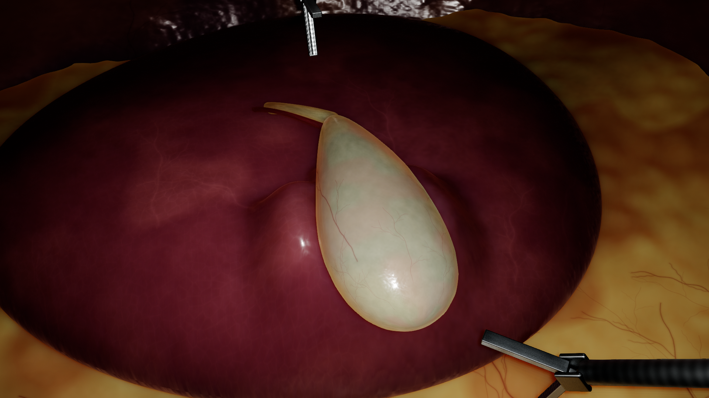
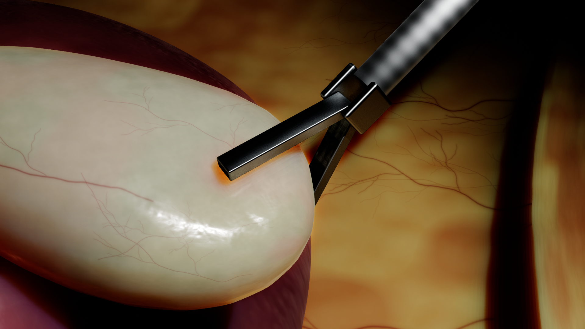
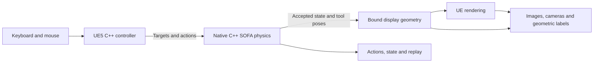

# EndoForge

**Endoscopic interaction, physical tissue deformation and traceable synthetic images.**

EndoForge is my research and development project, created and maintained by **Avalon ([avalon-lune](https://github.com/avalon-lune))**. I am building a shared simulation foundation for endoscopic training and image/geometry research. Unreal Engine 5 handles the scene, rendering and keyboard/mouse input; a separate native C++ SOFA process computes tissue mechanics. Third-party frameworks retain their own authorship and licenses.

**Current milestone: Phase 9 is ready for human visual and interaction review, as of 2 November 2026.** Development, scoped engineering checks, packaging and a fresh ZIP extraction/run are complete. Human visual approval remains pending. The current scene is a local gallbladder/liver workspace; the two research projects' specialized implementations have not started.

[Current status](docs/STATUS.md) · [Milestones 1–9](docs/MILESTONES.md) · [Open in UE / run](docs/START-HERE.md) · [Build](docs/BUILDING.md) · [Phase 9 scope](docs/PHASE9.md) · [Verification summary](docs/verification/phase9-summary.json) · [Research branches](docs/BRANCH-BOUNDARY.md)

## Actual Phase 9 images

These are unchanged captures from the verified fresh-extracted program, not concept renders. The revised gallbladder contour reduces the conspicuous lower-edge corners. Some shallow curvature bands remain visible in neutral-grey near views; surgical-image realism and anatomical approval are still open review items.





[Dual-instrument traction](docs/images/phase9/dual-traction.png) · [Organ closeup](docs/images/phase9/organ-closeup.png) · [Preserved Phase 8 contact view](docs/images/phase8/jaw-contact.png) · [Image provenance](docs/images/phase9/provenance.json)

## What currently works

| Area | Implementation and scope |
|---|---|
| Interaction | Two keyboard/mouse-controlled friction graspers: approach, grasp, traction, release, fine motion and observation controls |
| Tissue mechanics | Gallbladder wall with 724 physical nodes and 2,160 tetrahedra, neck constraints, support-weighted liver-bed attachment and static-liver contact |
| Organ presentation | Original editable Blender anatomy; a 92,160-triangle gallbladder display reconstructed from accepted physical nodes with a recorded 0.12 mm displacement bound |
| Rendering | DX12/SM6, Lumen GI and reflections, hardware ray tracing and close-range shadows, verified through actual runtime feature comparisons |
| Recording | Simulation-step actions, model/configuration identity, guarded replay and frozen state snapshots |
| Physical outputs | Solver node coordinates and velocities; signed world-coordinate per-jaw contact reactions, with units and last-accepted-substep validity |
| Image/geometry outputs | Stereo RGB, cameras, camera-axis depth, geometric normals, IDs, validity masks and actual displayed geometry tied to the corresponding state |
| Earlier technical modes | Flat/curved specimens and connectivity-changing cutting remain separate from the anatomy scene |

The liver is static; cavity/fat and duct/artery landmarks do not provide a complete deformable organ or dissection model. The hollow gallbladder wall has no luminal fluid-pressure model. Tissue parameters and contact reactions are not calibrated biological or handle-force measurements. Suturing, general full-shaft/self-contact, clinical training validity and complete research datasets are outside the current delivery.

## Development milestones

| Phase | Implemented result | Scope of that milestone |
|---|---|---|
| 1 | UE/native bridge and keyboard/mouse grasp–traction–release | Initial interaction foundation |
| 2 | Thick tetrahedral pad, native friction grasping and instrument detail | Technical tissue specimen |
| 3 | Grasper/scissors coordination, connectivity changes and post-cut deformation | Thin membrane cutting, not organ surgery |
| 4 | Flat/curved deformation, recording, replay and state capture; later straight-retreat collision correction | Expanded angle, speed and path checks |
| 5 | Original Blender gallbladder, liver and local cavity; liver-bed attachment and two-tool traction | First anatomical engineering scene and paired outputs |
| 6 | Improved input/observation, detailed display, advanced rendering and sustained-grasp fixes | Verified common interaction/rendering/data foundation; r2 delivery |
| 7 | Smoothed physical/display liver, revised materials/UVs/attachment display and stable execution recording | Fresh native qualification and packaged/extracted checks |
| 8 | Reference-guided common appearance and curved landmarks; integrated delivery checks | Phase 7 native qualification inherited; four internal alignment frames |
| **9** | **Revised gallbladder physical/display surface, organ appearance, weighted attachment, velocities and signed jaw reactions** | **Fresh native and geometry qualification; packaged/extracted verification complete; human visual review pending** |

[Milestone details](docs/MILESTONES.md) distinguish each stage's results and limitations. Phases 1–8 local deliveries remain preserved. Historical results belong to their recorded binaries and assets; they do not automatically qualify a new build or modified model.

## Phase 9 verification

The [public summary](docs/verification/phase9-summary.json) identifies the locally verified build and archive. The [source/asset inventory](docs/verification/phase9-source-assets.json) binds the published engineering inputs to that build. Full trajectories and local delivery receipts remain local; this source update does not claim a clean-machine rebuild or clinical validation.

| Check or measurement | Recorded result |
|---|---|
| Fresh native suite | 35 cases, including 15 sustained-grip cases; all 62,958 hold states independently inspected |
| Reference/matrix/nominal geometry | 26 independent contact/liver audits |
| Repeated exercise | 50 cycles; full contact/liver audits of 21,865 states |
| Package and fresh ZIP extraction | Actual interaction, replay, rendering, snapshot, output correspondence and complete presented-trajectory audits passed |
| Fresh-extracted display | 1920×1080, 56.09 FPS; frame P95 21.158 ms |
| Local input response | P95 111.76 ms, controller event to accepted state received in UE; not motion-to-photon latency |
| Physical progression | 0.954748 simulated seconds per live wall second in the documented measurement window |
| Internal paired outputs | Four stereo frames for regression; not a research dataset |

Performance is scoped to the recorded workstation and measurement window. Geometry checks cover the tested actions and sampled/interpolated states, not every possible path or a general continuous-collision guarantee. Earlier [Phase 6](docs/verification/phase6-summary.json), [Phase 7](docs/verification/phase7-summary.json) and [Phase 8](docs/verification/phase8-summary.json) measurements remain separately documented.

## Open the editable project

The complete project is [Prototype/LapTrainer/LapTrainer.uproject](Prototype/LapTrainer/LapTrainer.uproject). Install the separately distributed UE/toolchain dependencies and follow [BUILDING](docs/BUILDING.md). Hydrate the UE assets before opening them:

```powershell
git lfs install
git lfs pull
```

After building the native service and UE editor module, use two PowerShell terminals from the repository root:

```powershell
# Terminal A: keep matching physical simulation running.
& .\Scripts\StartPhase9Development.ps1 -Mode Physics
# Terminal B: full UE editor, then normal Play. Set your own engine path.
& .\Scripts\StartPhase9Development.ps1 -Mode Editor -EngineRoot 'E:/UE_5.7'
```

The launcher selects Phase 9, its explicit assets and matching development port 47391. Opening the project alone does not start native physics or select this milestone. `-Mode Preview` starts a standalone editor-game preview; `-DryRun` prints the arguments. [START-HERE](docs/START-HERE.md) explains controls and shutdown. Physical instruments and force-feedback hardware are not required.

## Architecture and source map



| Location | Purpose |
|---|---|
| [Physics](Physics) | Native C++ mechanics, contact/guards, state protocol, reaction definitions and validation |
| [Prototype/LapTrainer/Source](Prototype/LapTrainer/Source) | UE C++ controller, bridge, scene, display binding and exporter |
| [Prototype/LapTrainer/Content](Prototype/LapTrainer/Content) | Hydrated UE assets for the authored scenes; tracked with Git LFS |
| [Assets/Phase9](Assets/Phase9) | Current original Blender scene, FBX/textures and physical/visual asset definitions |
| [Scripts/BlenderPhase9](Scripts/BlenderPhase9) | Original modeling/material generation; earlier authoring dependencies are retained |
| [Scripts/Phase9](Scripts/Phase9) | Native qualification, identity, geometry/image audits and candidate assembly |
| [docs](docs) | Stage explanations, startup/build guidance, actual screenshots, results and limitations |

The runtime mechanics and UE application are C++. Python supports asset authoring, independent audits and delivery tooling. Native coordinates use metres; UE uses centimetres; image depth uses camera-axis Z in millimetres. Geometric normals exclude material normal maps. Read [the Phase 9 physical-output contract](Physics/README-Phase9-Output.md) for signs, indexing and sampling semantics. UE does not run a second Chaos tissue solver.

## Current stopping point and next directions

The common foundation has reached **human visual/interaction review**. Inspect remaining curvature bands, anatomical proportions, material appearance and deformation before treating appearance as approved. This is the shared base preceding the research split:

- **Project 1:** stereo endoscopic highlight/image research, with its own appearance decomposition, masks, geometry definitions and output requirements.
- **Project 2:** colon/endoscope sequences, requiring a new colon scene, folds, camera/instrument motion and temporal correspondence requirements.

A later surgical-camera appearance profile can add calibrated camera response, lens effects and noise to the common scene. That imaging profile is a separate decision from the two research branches. [Branch responsibilities](docs/BRANCH-BOUNDARY.md) and [ROADMAP](docs/ROADMAP.md) record this boundary; neither specialized branch is delivered here.

## Repository and local delivery

This repository publishes project source, original necessary assets, development/verification tools, stage documentation and selected actual screenshots. SDKs, UE itself, build caches, recordings, raw trajectories, local packaged programs and tutor-provided reference packages are excluded. See [third-party provenance](docs/THIRD_PARTY.md).

The locally verified review archive is `EndoForge-Phase9-review-final01.zip`, 657,979,520 bytes, under `output/Phase9/`. Its package starts with `StartTrainer.cmd` and contains a Chinese visual-review guide. It is **not hosted as a GitHub release by this source update**. Exact historical Phase 9 delivery recipes are preserved separately as [inspection material](docs/verification/phase9-tools/README.md); they are not substitutes for the omitted raw evidence.
