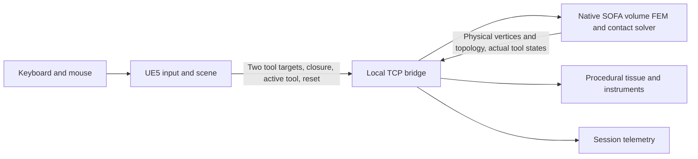
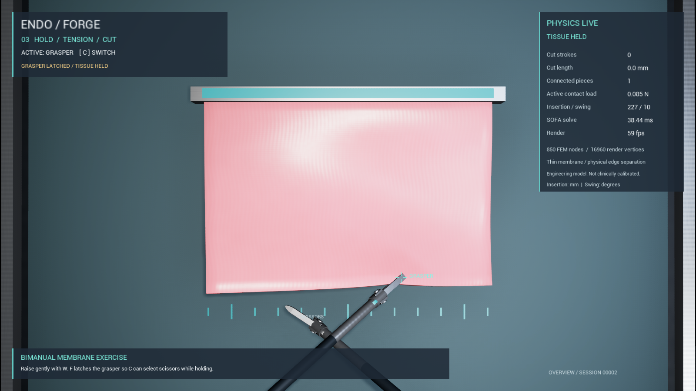
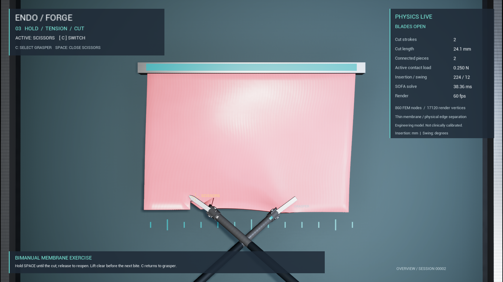
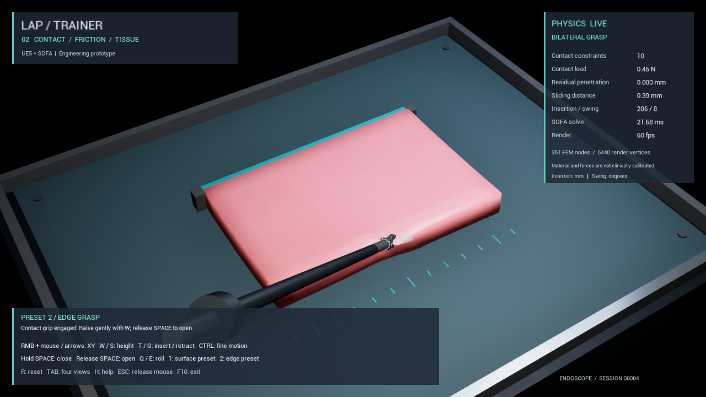
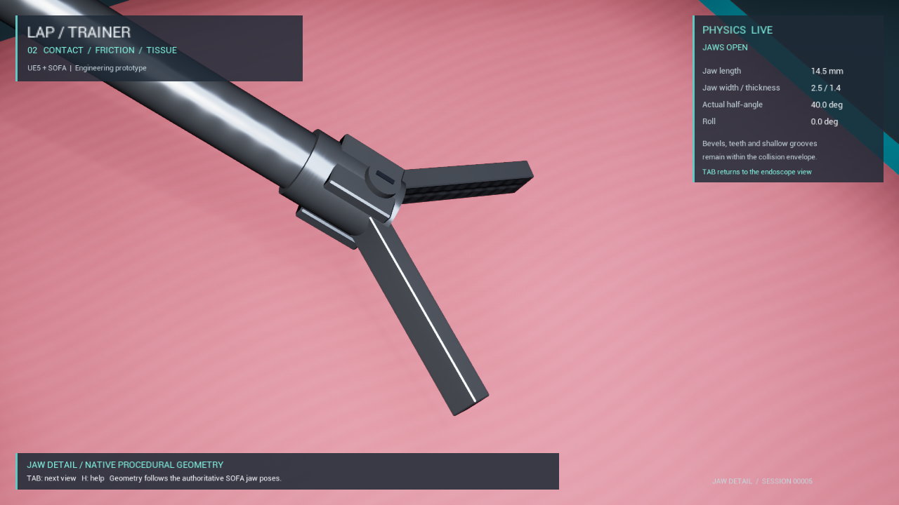

# EndoForge

**Endoscopic training, grounded in physics.**

EndoForge explores a practical route from a desktop tissue interaction prototype to a laparoscopic skills training environment. Unreal Engine 5 handles the view, instruments, materials and keyboard/mouse interaction. A separate native SOFA process owns tissue deformation, contact and cutting.

The current locally verified milestone is **Phase 3: a grasper and scissors acting on a thin training membrane**. The objective is a reproducible hold–tension–cut–release exercise in which an incision changes mechanical connectivity. The earlier single-grasper Phase 2 pad remains available in its separately preserved local package and the repository history.

**Engineering prototype:** materials, forces and educational outcomes have not been clinically validated. The intended progression includes suturing, selected anatomical scenes, calibration against physical measurements and clinician-led evaluation. Neither an attractive image nor a passing software test establishes clinical effectiveness.

[Phase 3 model and build workflow](docs/PHASE3.md) · [Controls / 操作说明](Scripts/README-Phase3.md) · [Roadmap](docs/ROADMAP.md) · [Protocol](docs/PROTOCOL3.md) · [Dependencies](docs/THIRD_PARTY.md)

## Current implementation

| Area | Phase 3 behavior |
|---|---|
| Instruments | Independent grasper and scissors targets, actual returned jaw frames, per-tool trocar constraints |
| Coordination | Switch the selected tool while a deliberately latched grasper retains its closure and target |
| Tissue | Thin volume of corotational tetrahedral FEM tissue with frictional contact |
| Cutting | Closing scissors split material connectivity through the thin layer; element volumes and mass are retained |
| After cutting | Physical deformation continues on the updated mesh; sufficiently extended cuts can create separate components |
| Rendering | Detailed procedural instruments and linearly bound tissue surface; topology, positions and both tools commit together |
| Recovery | Release, reset to intact topology, command timeout handling and numerical health reporting |
| Observation | Four views, selected-tool state, cut/component counters and per-tool session CSV telemetry |

Cutting resolves to the physical mesh edges. It is not arbitrary volumetric organ remeshing, a fracture-energy law or a prediction of surgical cutting force. Contact geometry is simplified; the rendered tissue includes the physical upper/lower surfaces and newly exposed cut sidewalls. See the [precise physical scope](docs/PHASE3.md) for final model parameters, discretization and exclusions.

## Architecture



Phase 3 uses protocol 3 on `127.0.0.1:47323`. Physics coordinates are metres; UE renders in centimetres. The instruments follow returned actual poses, and UE does not run a second Chaos simulation on the same tissue. Both endpoints validate data and handle loss of communication.

| Location | Purpose |
|---|---|
| [`Prototype/LapTrainer`](Prototype/LapTrainer) | UE project, C++ scene/HUD/bridge, map, materials and asset scripts |
| [`Physics`](Physics) | SOFA service, Phase 2 and Phase 3 models, dependency manifest and regression tests |
| [`Scripts`](Scripts) | Integration, packaging, launch and relocation verification scripts |
| [`docs`](docs) | Model scope, protocol, build guidance, roadmap and screenshots |

`LapTrainer` remains the internal UE project/executable identifier. EndoForge is the public name and Phase 3 display branding.

## Build and run

The development configuration is **Windows x64, UE 5.7.4, Visual Studio 2022 C++ tools and SOFA 26.06.00**. Downloaded native dependencies stay in `ThirdParty/` and use pinned SHA-256 checks. UE and the Microsoft toolchain are installed separately. Runtime interaction requires no Blender, physical instruments, SofaPython3 or cloud service.

Start with the toolchain and Git LFS notes in the [build guide](docs/BUILDING.md), then the [Phase 3 workflow](docs/PHASE3.md):

```powershell
$EngineRoot = 'E:/UE_5.7' # Your installed UE directory
& .\Physics\download-dependencies.ps1
& .\Physics\build.ps1
& .\Physics\RunPhase3Regression.ps1
& .\Prototype\LapTrainer\Scripts\Build.ps1 -EngineRoot $EngineRoot -Target Editor
& .\Scripts\RunPhase3Protocol.ps1 -EngineRoot $EngineRoot
& .\Scripts\RunPhase3Integration.ps1 -EngineRoot $EngineRoot
```

For manual development play, start `Physics/runtime/LapPhysics.exe`, then `Prototype/LapTrainer/Scripts/RunEditor.ps1 -EngineRoot $EngineRoot -Game`. A packaged distribution is launched with `StartTrainer.cmd`, which manages its own physics process.

The Phase 3 assembler writes to `output/Phase3/EndoForge/`; the finalizer produces `output/Phase3/EndoForge_Phase3_Win64.zip`. Generated binaries, SDKs and local verification runs are excluded from Git. A local package does not imply a published GitHub Release or a verified clean-machine build.

## Controls

| Control | Action |
|---|---|
| C | Select grasper or scissors |
| F | Toggle the selected grasper latch; release an existing latch while scissors are selected |
| Hold / release Space | Close / open the selected instrument; a latched grasper stays closed |
| Right mouse + motion, or arrows | Move selected tip in the camera-relative horizontal plane |
| W / S; mouse wheel | Raise / lower the selected tip |
| T / G | Insert / withdraw along its shaft |
| Q / E | Rotate about its shaft |
| Ctrl / Shift + movement | Fine / faster command motion, within native limits |
| 1 / 2 | Reset to initial / grasp-ready preset |
| 3 | Select and reposition open scissors without resetting the specimen |
| R | Restore intact tissue and release both tools |
| Tab / H | Cycle views / toggle help |
| Esc | Release both tools and the mouse; right-click to resume |
| F10 | Exit |

Press **2** and let the open grasper finish its approach. Then close it with **F** and wait for actual holding feedback. Raise gently with **Ctrl+W**. Press **C** to operate the scissors while retaining the grasp. Place the deformed tissue between the blades and close with **Space**; reopen before another bite. Return to the grasper to inspect traction across the cut, or use **F** to release it. The [Chinese test guide](Scripts/README-Phase3.md) explains the complete workflow.

## Verification

The test layers are distinct:

- Native numerical checks exercise actual constitutive behavior, topology transfer, mass preservation, separation and reset.
- Real TCP checks exercise command validation, two tools, watchdog and dynamic topology transport.
- UE protocol automation checks atomic rejection of invalid geometry/tools, topology revisions and reset acknowledgements.
- `-LapPhase3Test` drives the normal PlayerController key path and inspects returned physics, with screenshots and CSV telemetry.
- Packaged and freshly extracted archive tests verify exact executable hashes, included dependencies and the same interaction path.

The delivered local build passed 19 native checks, 19 TCP checks and 17 packaged input checks, followed by a fresh ZIP extraction and another successful packaged run. The [Phase 3 verification summary](docs/verification/phase3-summary.json) records binary hashes, measured timing and limits.

Only actual successful receipts establish a completed run. Reports live under `output/verification/` and in the delivered package's `Verification/` directory. An independent source rebuild from a clean public clone on another machine remains separate work. Software input tests do not replace manual usability testing or clinician review.

Contact load is a sum of modeled contact-force magnitudes, not a measured handle force or tissue damage threshold. Sampled penetration checks are not a proof that all continuous surfaces are intersection-free. The timestep is a solver setting; achieved timing must be measured on the delivered workload.

## Phase 3 packaged captures

These are unmodified captures from the packaged Windows input acceptance. The [verification summary](docs/verification/phase3-summary.json) identifies the tested binaries and results. The physical cut follows the 5 mm material mesh; rendered detail does not refine that resolution.





## Phase 2 baseline

These images show the earlier verified thick-pad prototype with its former HUD branding:





The [Phase 2 verification summary](docs/verification/phase2-summary.json) records that historical package. It is not evidence for the newer cutting implementation. Prior local deliveries in `output/Phase1/` and `output/Phase2/` are preserved.

## Direction and license

Next work builds on the cutting milestone with needle/thread mechanics and suturing, followed by selected anatomy, physical calibration and clinician-led evaluation. Haptics requires a separate stability and hardware integration design. See the [roadmap](docs/ROADMAP.md) for completion criteria and boundaries.

**The project license has not yet been specified.** Public availability is not an MIT or other open-source license grant for project-authored code/assets. Third-party components retain their own licenses; Unreal Engine is governed by Epic's terms. See [dependency and redistribution notes](docs/THIRD_PARTY.md) and the [pinned manifest](Physics/dependencies.json).
