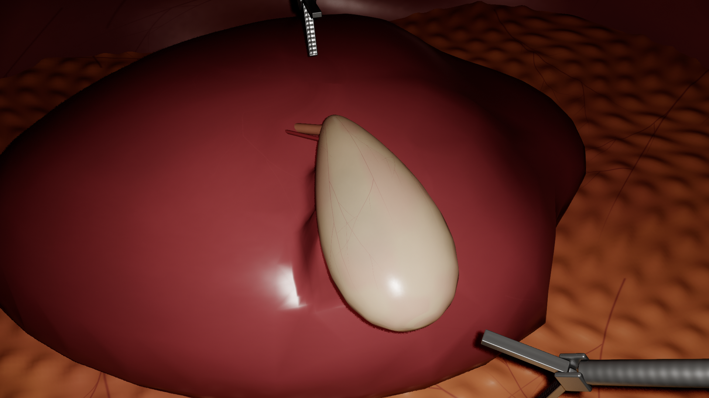
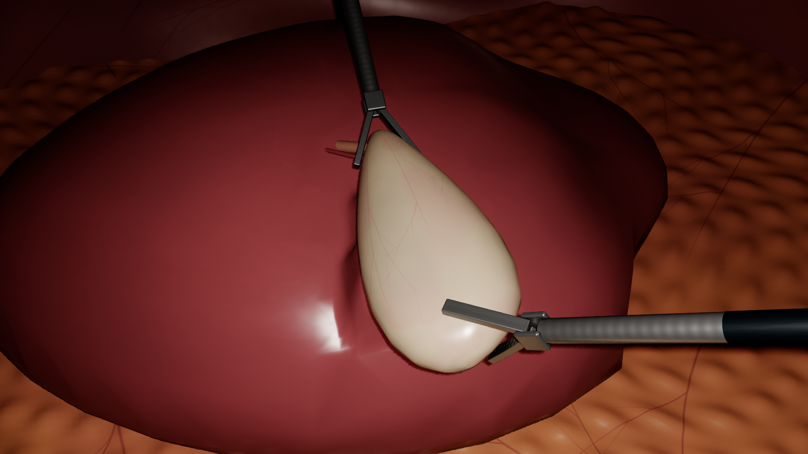
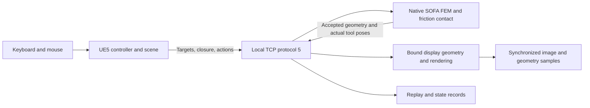

# EndoForge

**Endoscopic simulation, physical deformation and traceable synthetic data.**

EndoForge is my research and development project, created and maintained by **Avalon ([avalon-lune](https://github.com/avalon-lune))**. I am building a shared foundation for endoscopic interaction and image/geometry research. Unreal Engine 5 presents the scene and handles keyboard/mouse input; a separate native SOFA process computes tissue mechanics. Third-party frameworks retain their own authorship and licenses.

**Current milestone: Phase 6 r2 passed local engineering delivery acceptance on 24 October 2026.** The editable UE project, original Blender models, textures, physics source and validation tools are included. This is a working engineering prototype, **not finished surgical photorealism, a complete research dataset, or a clinically validated training system**. Visual refinement and task-specific outputs remain substantial next steps.

[Current status and limitations](docs/STATUS.md) · [Milestones 1–6](docs/MILESTONES.md) · [Open in UE / start](docs/START-HERE.md) · [Build](docs/BUILDING.md) · [Phase 6 results](docs/verification/phase6-summary.json) · [Roadmap](docs/ROADMAP.md)

## What is working

| Area | Current Phase 6 implementation |
|---|---|
| Interaction | Two keyboard/mouse-controlled friction graspers; independent selection, closure, approach, traction and release |
| Anatomy | Original editable gallbladder, liver and local abdominal environment; orientation landmarks |
| Mechanics | Corotational tetrahedral gallbladder wall, neck constraints, compliant liver-bed attachment and contact/friction |
| Boundaries | Static liver contact and geometric jaw-motion guard; guard blocking is not measured reaction force |
| Presentation | Detailed display geometry bound to accepted physical states; original tissue/metal materials and textures |
| Rendering | Actual D3D12/SM6, Lumen GI/reflections, hardware ray tracing and near-contact shadow comparisons verified |
| Recording | Simulation-step actions, guarded replay, model/state identity and matching frozen snapshots |
| Basic exports | Short stereo RGB sequences, camera parameters, depth, geometric normals, object IDs, masks and rendered geometry |
| Earlier modes | Flat/curved technical specimens and mesh-edge cutting remain available in explicit legacy modes |

The anatomy scene does **not** support gallbladder dissection or suturing. Liver and cavity geometry are primarily static, not fully deformable organs. Visible polygon count does not establish FEM resolution or anatomical accuracy.

## Development milestones

| Phase | Work completed | Engineering scope |
|---|---|---|
| 1 | External physics bridge and grasp–traction–release loop | Desktop interaction foundation |
| 2 | Native friction grasping on a thick tissue pad; instrument improvements | Preserved baseline |
| 3 | Grasper/scissors coordination and physical connectivity changes during cutting | Thin technical membrane, not organ surgery |
| 4 | Flat/curved deformation, replay, snapshots; subsequent straight-retreat collision correction | Expanded angle/speed/path checks |
| 5 | Original Blender anatomy, deformable gallbladder, liver-bed attachment and two graspers | First anatomical engineering scene and paired exports |
| **6** | **Shared interaction/rendering/data foundation, sustained-grasp fixes and r2 verification** | **Locally accepted engineering build; appearance and specialized outputs unfinished** |

See [milestone details](docs/MILESTONES.md). Earlier local deliveries remain preserved; a later result is not evidence for an earlier binary.

## Actual Phase 6 packaged images

These are unmodified accepted r2 package captures, not concept art. Pale tissue appearance, simplified vascular detail and remaining broad-highlight faceting are visible limitations.





[Jaw contact](docs/images/phase6/jaw-contact.png) · [Organ closeup](docs/images/phase6/organ-closeup.png)

## Local acceptance results

The [public summary](docs/verification/phase6-summary.json) records selected results and exact executable/archive hashes from the sealed local receipt. Full raw trajectories and per-frame exports remain in the local evidence-bearing delivery.

| Measurement | Accepted result / scope |
|---|---|
| Native suite | 35 cases, including 15 sustained-grip cases |
| Continuous exercise | 50 cycles / 727.17 simulated seconds |
| Long hold | 60 s grasp + 60 s after traction per case, then closed retraction and release |
| Dual traction | +2.000 mm per instrument; tissue increment about 2.229 mm in the fresh-extraction run |
| Fresh extracted package | Complete input, release, record/replay, snapshot and 24-frame stereo exercise passed |
| Display | 1920×1080, mean 59.87 FPS on the recorded RTX 5080 workstation |
| Local input response | P95 100.03 ms, controller event to accepted state received in UE; not motion-to-photon |
| Physical progression | 0.9879 simulated seconds per wall second in the documented live window |
| Preservation | 2,314 prior-delivery/reference files unchanged |

Performance excludes frozen exports under the stated measurement scope. These results do not guarantee another PC, arbitrary paths, untested parameters or clinical behavior. The first 24 October ZIP failed a precise-lift endpoint gate. **r2** corrected test-driver command/settlement timing and passed new package and fresh-extraction runs without relaxing the original tolerance. See [status and correction](docs/STATUS.md#phase-6-r2-correction).

## Open the complete UE project

The editable project is [`Prototype/LapTrainer/LapTrainer.uproject`](Prototype/LapTrainer/LapTrainer.uproject). **Opening it and pressing Play without selecting Phase 6 is not equivalent to starting this milestone.** Native physics and UE require matching Phase 6 arguments, assets and port.

After [building the native runtime and editor module](docs/BUILDING.md), use two PowerShell terminals from the repository root:

```powershell
# Terminal A: keep the physical simulation running.
& .\Scripts\StartPhase6Development.ps1 -Mode Physics
# Terminal B: full UE editor, then click Play.
& .\Scripts\StartPhase6Development.ps1 -Mode Editor -EngineRoot 'E:/UE_5.7'
# -Mode Preview uses the editor executable as a standalone game preview.
```

The new development helper is a launch convenience. Its dry-run/argument checks are separate from accepted r2 binary tests. Read [START-HERE](docs/START-HERE.md) for prerequisites, controls, shutdown and that distinction. Blender is required for model editing/regeneration, not for playing. Physical instruments and haptics are not required for this keyboard/mouse milestone.

The local package starts with `StartTrainer.cmd`. The approximately 4.05 GB r2 ZIP is **not hosted as a release by this source synchronization**. It includes source, runtime dependencies/notices and extensive raw evidence. SDK downloads, UE itself, build caches, sessions and tutor-provided reference packages are excluded from the public repository.

## Architecture and source map



| Location | Purpose |
|---|---|
| [`Prototype/LapTrainer`](Prototype/LapTrainer) | Editable UE project, C++ scene/bridge/controller, map, materials and imported assets |
| [`Physics`](Physics) | Native mechanics, shared recipes, guards, protocols, replay and tests |
| [`Assets/Phase6`](Assets/Phase6) | Current editable Blender scene, physical/visual definitions, FBX and textures |
| [`Assets/Phase5`](Assets/Phase5) | Original anatomy baseline used by current generators |
| [`Scripts/BlenderPhase6`](Scripts/BlenderPhase6) | Modeling and material authoring/verification |
| [`Scripts/Phase6`](Scripts/Phase6) | Identity, geometry/data audits, preservation and delivery |
| [`docs`](docs) | Stage explanations, startup/build guidance, screenshots, evidence and limitations |

Phase 6 uses native `--phase6`, UE `-LapPhase6`, protocol 5 and normally port `47329`. Native units are metres; UE uses centimetres. `LapTrainer` remains the internal project/executable name. UE does not apply a second Chaos soft-body solver to the same tissue.

## Next work and ownership

My next priorities are anatomical/visual refinement, supervisor/clinician review, manual usability evaluation and agreement on the two research projects' exact output contracts. Specialized scenes, datasets and calibration follow those requirements. Suturing is deferred. See [ROADMAP](docs/ROADMAP.md).

**Project author and maintainer: Avalon.** A project-wide reuse license has not been selected; public availability is not an MIT license grant. Dependencies retain their licenses and attribution. See [third-party provenance](docs/THIRD_PARTY.md).
