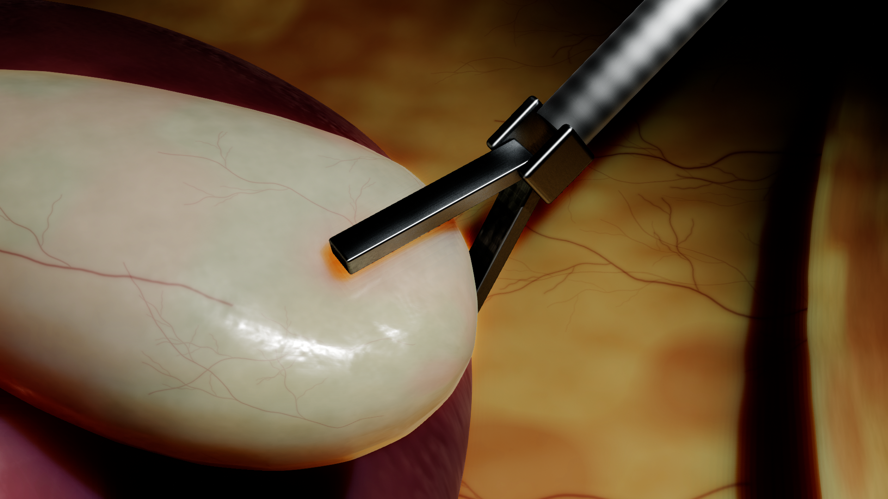

# Phase 9 — smoother organ shape and physical output

Author and maintainer: **Avalon**.

This milestone prepares the common EndoForge scene for direct visual and
interactive review. It addresses the conspicuous polygonal lower outline of the
gallbladder, the way the display surface follows physical deformation, and the
definition of recorded velocities and contact reactions. It does not implement
either research project's specialized branch.

## What changed

- Revised original gallbladder geometry, wall discretization and display
  reconstruction. The current physical wall has 724 nodes and 2,160
  tetrahedra; the displayed gallbladder has 92,160 triangles. These are
  different representations with an explicit binding, not interchangeable
  measures of biological accuracy.
- A smoother asymmetric outline, finer regional appearance and vascular
  detail, and revised surrounding fat/folds. Grey diagnostic views expose
  shape without relying on coloured highlights to hide it.
- Display geometry is rebuilt from the accepted physical state with a recorded
  0.12 mm maximum reconstruction offset. Image/depth/geometric-normal outputs
  use that actual geometry. Shading normal maps remain a separate quantity.
- Support-weighted liver-bed attachment and a faster explicitly recorded
  native execution policy. Physics advances through real solver steps; slow
  rendering is not compensated by inventing simulation time.
- Actual solver node velocities and signed, world-coordinate per-jaw contact
  reactions, with units and validity attached to the last accepted substep.
  The older sum of contact-force magnitudes remains a separate legacy field.

## What to review visually

The packaged jaw view has a more continuous lower outline than the Phase8
comparison. Shallow distal curvature bands remain visible in some neutral-grey
near views. Static liver/context geometry also remains simplified. This is a
review candidate, not a statement that every visible facet has disappeared or
that surgical-image realism has been achieved.

Inspect rest, unilateral traction, bilateral traction and release while orbiting
the camera. Check the distal outline, contact indentation, texture attachment,
liver-bed transition and whether apparent corners move consistently with actual
tool contact. The comparison gallery contains unchanged UE captures rather than
painted previews. Automated collision tests cannot approve these visual qualities.

## Run and edit

The review package's `StartTrainer.cmd` starts the included UE program and native
physics service. `TESTING.zh-CN.md` lists controls and the focused visual checklist;
`Evidence/visual_gallery.html` provides before/after and grey inspection views.
The package does not require installed UE, Blender, Python or physical tools.

The full editable workspace project remains
`Prototype/LapTrainer/LapTrainer.uproject`. Start matching physics and the full
editor in two PowerShell terminals from the workspace root:

```powershell
& .\Scripts\StartPhase9Development.ps1 -Mode Physics
& .\Scripts\StartPhase9Development.ps1 -Mode Editor -EngineRoot 'E:/UE_5.7'
```

The second command belongs in the other terminal; use normal Play in the editor.
The helper selects Phase9 explicitly. Double-clicking the project alone does not
select the milestone or start physics. The original Blender scene is under
`Assets/Phase9/`. Package source is included for inspection; a clean-machine
authoring rebuild is not claimed.

## Physical and delivery limits

The hollow wall uses an uncalibrated corotational isotropic material and has no
luminal fluid-pressure model. Liver contact is static. Cavity/fat and duct/artery
landmarks are not a complete deformable anatomy or surgical dissection model.
Signed jaw reactions are solver contact quantities, not calibrated handle forces.
Suturing, general full-shaft/self-contact, complete dissection and specialized
Project1/Project2 outputs are outside this milestone.

Native qualification is freshly executed for Phase9 rather than inherited from
Phase8. Package checks bind the executable, mesh, rendering geometry and version.
Four stereo frames are internal correspondence checks, not a research dataset.
Human visual approval remains pending until supplied by the reviewer. Prior
deliveries and source references remain preserved.

Engineering checks and actual fresh ZIP extraction/run passed on **2 November
2026**. Fresh-extracted 1920×1080 measurements: **56.09 FPS**,
**21.158 ms frame P95**, **111.76 ms
local input response P95**, **0.954748 simulated
seconds per live wall second**. These are scoped local measurements, not
motion-to-photon latency or another machine's performance guarantee.

Fresh native35, all15 raw sustained-grip state audits (62,958 states), all26
reference/matrix/nominal contact and liver audits, and full endurance contact/liver
audits (21,865 states) passed. Both actual package captures have eight independent
audits, including complete unresampled presented-trajectory geometry. The final
extracted run covers 1,547 presented
states and 4,626 non-reset contact
interpolation samples. The exact [engineering summary](verification/phase9-summary.json)
binds executable, mesh, ZIP and evidence hashes. Human visual approval is pending.

Local delivery: `output/Phase9/EndoForge-Phase9-review-final01/`; archive:
`output/Phase9/EndoForge-Phase9-review-final01.zip`, 657,979,520
bytes. ZIP SHA256: `7607c4d0a645654286093d56d6452cbf39922f79276fea12254bb0fec198cfa7`. The final evidence summary is
`output/Phase9/phase9-review-verification-final01.json`. This local milestone does
not publish a GitHub release. Earlier eight phase deliveries remain preserved.



[Workspace](images/phase9/workspace.png) · [Dual traction](images/phase9/dual-traction.png)
· [Organ closeup](images/phase9/organ-closeup.png). Captures are copied unchanged;
their provenance is recorded beside them.
